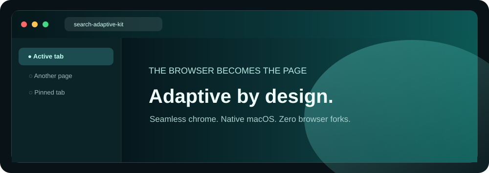

<div align="center">



# Search Adaptive Kit

**A page-aware color system for [Search Browser](https://searchbrowser.app/) on macOS.**  
Make your browser feel like an extension of the website, not a frame around it.

[](https://www.apple.com/macos/)
[](https://developer.apple.com/xcode/swiftui/)
[](#project-status)
[](https://github.com/driceroland/Search)
[](https://github.com/perfetto-day/search-adaptive-kit/actions/workflows/checks.yml)

**[Install](#quick-start)** · **[Features](#what-it-does)** · **[Russian guide](README_RU.md)** · **[Changelog](CHANGELOG.md)** · **[Upstream](https://github.com/driceroland/Search)**

</div>

---

## Why this exists

Search is a fast, minimal, native macOS WebKit browser. This project experiments with a more **seamless** look: the toolbar, sidebar, tabs and search overlay adopt the visible background of the active website.

This is **not** a Chrome / Safari extension. Search's interface is written in SwiftUI, so its native controls must be adapted at source level. Instead of maintaining a complete fork, the kit applies a narrowly scoped patch to an up-to-date upstream checkout and builds a **separate** app.

## What it does

| Feature | Implementation |
| --- | --- |
| **Adaptive toolbar** | Estimates the top-of-page background, prioritizing visible colors over page accent metadata |
| **Tinted tabs** | Uses hue-preserving HSL lightness adjustments for active, hovered and pinned tabs |
| **Smooth transitions** | Animates compatible color changes (~240 ms), without animating toolbar position |
| **Unified search overlay** | Keeps the last reliable page color; dims tabs/icons on search and matches Peek's 22% page shade |
| **Modal awareness** | Mirrors the actual RGB tint and alpha of common CSS modal backdrops |
| **Pixel validation** | Uses limited, occasional WebKit snapshots when CSS sampling is ambiguous |
| **Seamless rounded page top** | TabBar-hosted top corner cutouts above page compositor, enabled when no actual split is active; debug-on shows pink corners and ROUND DEBUG label |
| **Release notifications** | Optional official release checks (ON by default), never overwriting the patched app |
| **Repeatable updates** | Reapplies the patch to a clean Search checkout and builds `Search Adaptive.app` |

The color detector is heuristic. Complex canvases, videos, gradients, custom overlays, translucent content and split-screen layouts may not match perfectly.

## Quick start

**Requirements:** macOS 14+, full **Xcode** (not just Command Line Tools), Git and Python 3. Node.js is optional for the detector tests.

Clone **this** repository. For the v0.8 compatibility fix, select its Pull Request branch before building:

```bash
git clone https://github.com/perfetto-day/search-adaptive-kit.git
cd search-adaptive-kit
git switch feat/v0.8-native-settings-seamless-corners
./update-and-build.sh
```

Enable adaptive coloring and launch the separate app:

```bash
./toggle-mode.command on
open "$HOME/Applications/Search Adaptive.app"
```

> The installation script works in a dedicated checkout under `~/Library/Application Support/SearchAdaptive/Search-source`. It resets **that managed checkout only**, builds the app, and installs it in `~/Applications`. Read the script before running it.

### Update

Close Search Adaptive, pull the latest kit changes, and run the build script again:

```bash
git pull --ff-only
./update-and-build.sh
```

Official Search release **checks and in-app announcements are enabled by default**. The modified app will **not install** official Search binaries automatically because they would erase the adaptive modifications. Rebuild with `./update-and-build.sh` when a release is announced. You can turn background checks off; manual checks remain available.

### In-browser settings & mod updates

Go to `search://settings/appearance` → **Search Adaptive** for native-styled settings (the same cards, switches and controls as Search itself). The neighboring **Mod updates** group lets you check GitHub versions and stage builds. These are the same preferences as `toggle-mode.command`. Reload already-open pages after enabling color detection.

For **optional GitHub-based mod updates**, click **Check GitHub**, select a branch or tag and review its exact commit SHA, then choose **Download & Build**. The build runs locally in a dedicated managed checkout and is **never automatically installed**. After a successful build, confirm **Install & Restart**. A failed build leaves the currently installed app untouched. Selecting a remote revision and building it executes that revision's code on your Mac; only use trusted commits.

The GitHub checker now reports the **actual HTTP status and GitHub error**, including API rate-limit timing. If the tags endpoint fails, it still displays the available branches. It requests JSON with explicit API/User-Agent headers.

The page rounding diagnostic is **pink only while** `debug-on` is active. Disable diagnostics after checking the geometry.

### Controls

```bash
./toggle-mode.command on          # adaptive UI
./toggle-mode.command off         # original Search palette
./toggle-mode.command debug-on    # show detected color / source / dimming
./toggle-mode.command debug-off
./toggle-mode.command search-on     # page-aware search overlay (default)
./toggle-mode.command search-off
./toggle-mode.command round-on      # top page corners (default)
./toggle-mode.command round-off
./toggle-mode.command updates-on    # check for official Search releases (default)
./toggle-mode.command updates-off   # disable background checks
./toggle-mode.command status
```

Restart the modified app after changing a setting.

## How it is organized

```text
AdaptiveChrome.swift           WebKit color sampling, palette and SwiftUI integration
apply_mod.py                   Guarded, repeatable upstream patcher
update-and-build.sh            Clone upstream, apply, build, install
toggle-mode.command            Local preference switches
AdaptiveSettings.swift          Appearance settings, GitHub reference browser and build UI
mod-update.command              Pinned-SHA stage/build/install helper
tests/                         Detector and patcher regression tests
README_RU.md                   Full Russian installation / troubleshooting guide
CHANGELOG.md                   Changes between prototypes
```

The patcher modifies **nine** upstream Swift sources: `Tab.swift`, `App.swift`, `Side.swift`, `TabBar.swift`, `Omnibox.swift`, `Updater.swift`, `Stage.swift`, `Settings.swift`, and `Fold.swift`. It recognizes both the original Search UI and the November 2026 `Side.swift` / `TabBar.swift` layout. On unrecognized future changes it still stops safely before modifying files.

## Tests

```bash
python3 tests/patcher.test.py
node tests/color-detector.test.js
bash -n update-and-build.sh toggle-mode.command mod-update.command
```

The tests cover patch application and JavaScript color heuristics. GitHub Actions attempts a macOS 26/Xcode 26 build to expose compiler errors, but even a green build **does not guarantee correct UI behavior**. Real WebKit/SwiftUI visual testing remains necessary.

## Project status

**Experimental v0.8** — an independent prototype, not a signed, verified browser release. Expect rough edges. The separate app may use Search's existing application identity and profile settings: back up your browser data before the first run. Do not treat this as an isolated browser security profile.

Contributions and bug reports are welcome, especially reproducible color mismatches and upstream patch conflicts. See [Contributing](CONTRIBUTING.md).

## Credits & legal

Based on [Search](https://github.com/driceroland/Search), developed by Office Commun, which is distributed under the [MIT License](https://github.com/driceroland/Search/blob/main/LICENSE). This repository contains an independent patch kit rather than a copy of the full upstream browser. See [LICENSE](LICENSE) and [third-party acknowledgments](THIRD_PARTY.md).

### Apple Passwords and passkeys in local builds

A self-built, ad-hoc-signed Search Adaptive app **does not inherit the official Search browser's code-signing identity or Apple permissions**. Apple's Passwords native helper may reject it, even when Apple Passwords works in the official Search release. Apple's browser helper uses a signed-browser allowlist; adding your own app requires a legitimate signed identity and Apple's inclusion process. Browser-wide passkeys require a separate restricted Apple entitlement. This cannot safely be enabled by changing a Swift flag or copying an entitlement.

See [Apple's browser allowlist process](https://github.com/apple/password-manager-resources#how-apple-uses-web-browser-extension-distribution-information) and [Apple's passkeys entitlement](https://developer.apple.com/documentation/bundleresources/entitlements/com.apple.developer.web-browser.public-key-credential). [Russian details](README_RU.md#apple-passwords-и-passkeys-в-собственной-сборке).

**Not affiliated with, sponsored by, or endorsed by Search Browser or Office Commun.**
